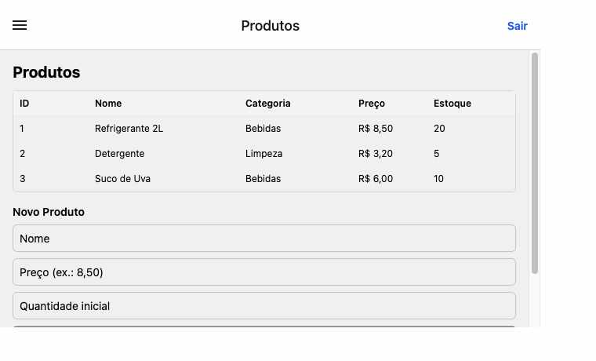
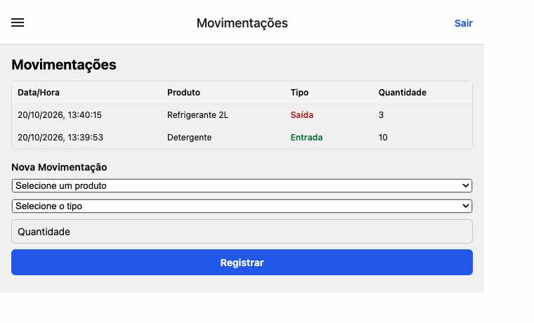

# Controle de Estoque

Aplicativo desenvolvido com React Native e Expo para cadastro de produtos e
registro de movimentações de estoque.

## Executar

```bash
cd appEstoque/frontend
npm ci
npm start
```

## Telas

### Produtos



### Movimentações

